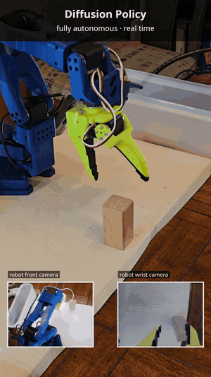

# SO-101 block-to-bin: ACT vs. Diffusion Policy vs. SmolVLA

Teaching an open-source [SO-101](https://github.com/TheRobotStudio/SO-ARM100) arm to pick up a wooden block and drop it
in a bin, entirely from teleoperated demonstrations, with [LeRobot](https://github.com/huggingface/lerobot). Three
policies trained on the same 125 demonstrations, each tested on the same 10 block placements on the real robot.

  

| Policy | Real-robot result | Model |
|---|---|---|
| ACT (Action Chunking Transformer), with temporal ensembling | **9/10** | [`lichtphyz/act_v3_aug_desktop`](https://huggingface.co/lichtphyz/act_v3_aug_desktop) |
| Diffusion Policy, 5-step DDIM | **8/10** | [`lichtphyz/diffusion_v3_desktop`](https://huggingface.co/lichtphyz/diffusion_v3_desktop) |
| SmolVLA (fine-tuned vision-language-action model), first attempt | **7/10** | [`lichtphyz/smolvla_v3_desktop`](https://huggingface.co/lichtphyz/smolvla_v3_desktop) |

Everything is on Hugging Face: the models, the training data, and every evaluation episode with both camera views.
**[SO-101 block-to-bin collection →](https://huggingface.co/collections/lichtphyz/so-101-block-to-bin-act-vs-diffusion-policy-6ad6ca5c5e111b426bb1f8a6)**

## How it works

1. **Demonstrate.** I moved a leader arm by hand while the follower copied it, recording a front (workspace) camera, a
   wrist camera and the joint positions at 30 fps: 100 pick-and-place demonstrations, 15 "empty table, stay at rest"
   episodes and 10 "miss, then regrasp" recovery episodes
   ([`so101_block_to_bin_v3`](https://huggingface.co/datasets/lichtphyz/so101_block_to_bin_v3)).
2. **Train.** Behavior cloning: each policy learns to predict the demonstrated arm motion from the camera images and
   joint state. All three use image augmentation (lighting changed between the evening demos and the morning tests).
   Trained on one RTX 4080, 2.5–11 hours each.
3. **Evaluate.** Each policy ran autonomously for 10 episodes of up to 30 s, with the block placed at the same 10 spots,
   recorded as a dataset for review.

The exact commands are in [docs/training.md](docs/training.md).

## What I learned

- **Consistent demonstrations matter more than the model.** The first ACT model succeeded about 25% of the time: I had
  turned the wrist both ways for similar block positions, and the policy averaged the two into a grasp that matched
  neither. Re-recording with grid-aligned blocks and one consistent grasp fixed it.
- **Show it what to do when there's nothing to do.** With an empty table the arm wandered around. Fifteen short "stay
  at rest" episodes taught it to wait.
- **Start moving promptly in demonstrations.** The demos began with about 2 s of stillness, so a policy that re-plans
  often (ACT with short action chunks) predicted "stay still" from the rest pose and never started.
- **Inference settings matter as much as training.** With its default open-loop action chunks, an earlier ACT model
  often missed the block; switching to temporal ensembling at run time, with no retraining, made it succeed 5 times in
  5 tries. Diffusion Policy runs with 5 DDIM steps instead of 100.
- **Recovery demonstrations help, carefully.** Ten "miss, then regrasp" episodes help the policy retry (Diffusion does
  this in one of its evaluation runs), but the deliberate miss is in the data too.
- **Both ACT and Diffusion struggled on the same two placements.** Diffusion failed both; ACT bumped the bin edge on
  them but still got the block in.
- **Bigger isn't automatically better.** SmolVLA (450M parameters, pretrained) often got a good first grasp but moved
  shakily and was the only one that wandered on an empty table. It was a quick first attempt with the default recipe.
- **Ten trials is a small sample.** 9/10 vs. 8/10 is within noise. The failures say more than the scores: which
  placements were hard, and how each policy failed.
- **Keep the scene clean.** The bin is translucent, so the wrist camera sees whatever is already in it. Demonstrations
  used one block in view and an empty bin.
- **Augmentation, not the GPU, set the training speed.** For Diffusion Policy, the hue and sharpness transforms took
  most of the data-loading time; the GPU sat idle about two thirds of the time. Dropping those two transforms halved
  training time (the ablation model); it wasn't tested on the arm.
- **Batch size mattered beyond speed for Diffusion Policy.** Its pretrained ResNet18 uses batch normalization, so
  batch 32 on the 16 GB desktop gives much steadier statistics than the laptop's batch 4–8.
- **Extra short-block tests** (not part of the 10-trial evaluations): ACT 4/4 and SmolVLA 4/5 with a shorter block,
  which Diffusion Policy had some trouble with.

Hardware lessons (camera bandwidth, calibration, a failed motor) are in [docs/hardware.md](docs/hardware.md).

## Repository layout

| Path | What |
|---|---|
| [`docs/training.md`](docs/training.md) | Environment, data, the training command for each model, run-time settings, evaluation |
| [`docs/hardware.md`](docs/hardware.md) | Arms, cameras, ports, calibration, and hardware lessons |
| [`env/`](env/) | `setup_env.sh` (one-command training environment, pinned LeRobot commit) and `requirements-lock.txt` |
| [`scripts/`](scripts/) | Wrappers for this setup: `record.sh`, `train.sh`, `eval.sh`, `common.sh` (ports, cameras, names), `setup.sh` (health check), `setup_one_motor.py`, `leader_stream_test.py` |
| [`learning/`](learning/) | [A guide to LeRobot's imitation-learning models](learning/LEROBOT_LEARNING_GUIDE.md) and small no-robot exercises (inspect a dataset, a minimal ACT training loop, inference timing) |

The wrapper scripts hold this setup's device paths and names; change them in `scripts/common.sh` or with environment
variables. The plain `lerobot-*` commands in the docs work on their own.

## Built with

[LeRobot](https://github.com/huggingface/lerobot) (commit `1e3a158e`), the SO-101 arm by
[TheRobotStudio](https://github.com/TheRobotStudio/SO-ARM100), and the papers behind the policies:
[ACT](https://huggingface.co/papers/2304.13705), [Diffusion Policy](https://huggingface.co/papers/2303.04137) and
[SmolVLA](https://huggingface.co/papers/2506.01844).

## License

Apache-2.0, like LeRobot and the models and datasets on Hugging Face.
